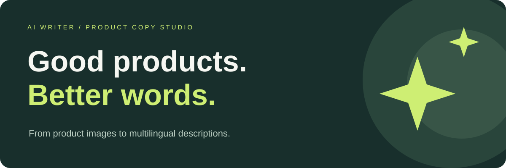
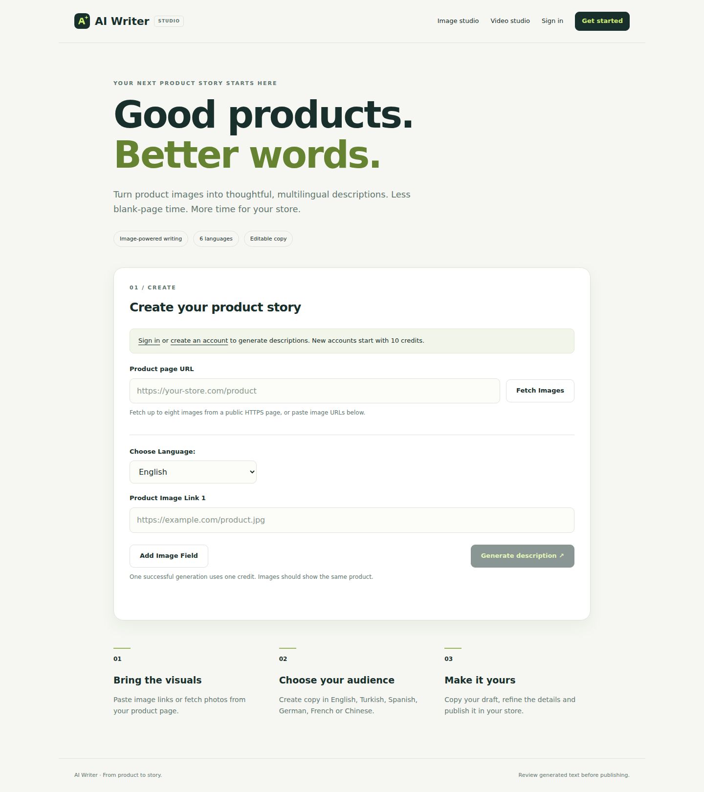

<p align="center"></p>
<p align="center">
  <a href="https://github.com/csadigital/ai-writer/actions/workflows/ci.yml"></a>
  
  
  
</p>
<p align="center"><strong>Turn product photos into clear, multilingual ecommerce copy.</strong><br>Paste images. Choose a language. Make the draft your own.</p>
<p align="center"><a href="#quick-start">Quick start</a> · <a href="#what-you-can-do">Features</a> · <a href="docs/DEPLOYMENT.md">Deployment</a> · <a href="README.tr.md">Türkçe</a></p>

## What you can do

- **Write from images:** generate descriptions from one to eight public HTTPS product photos.
- **Fetch product photos:** collect image links from a public product page using Puppeteer.
- **Write for your audience:** English, Turkish, Spanish, German, French and Chinese output.
- **Edit, copy and translate:** refine the draft in the browser and translate it with one action.
- **Manage accounts and credits:** bcrypt passwords, MySQL sessions, ten starter credits and refunds for failed generation requests.
- **Explore video drafts:** extract up to eight frames from a short YouTube video. This integration is experimental and depends on upstream YouTube downloader availability.



AI Writer produces drafts. Verify product claims before publishing; an image cannot reliably establish fabric composition, measurements or certifications. The application prompts the model to avoid inventing such details.

## Quick start

### Requirements

- Node.js **22.12 or later** and npm
- Docker with Compose **or** an existing MySQL 8+ server
- An OpenAI API key with access to a vision-capable Chat Completions model
- Chrome installed by Puppeteer for page image fetching
- FFmpeg and FFprobe on `PATH` for the experimental video feature

### Automatic setup

```bash
git clone https://github.com/csadigital/ai-writer.git
cd ai-writer
npm run setup
npm start
```

The installer downloads dependencies and Chrome, asks for your OpenAI key without echoing it, generates session/database secrets and initializes MySQL. Choose **docker** to start a persistent MySQL container automatically, or **existing** to use your own server. For an existing server it can create a dedicated database and app user with administrator credentials; the administrator password is never saved. Existing `.env` values are preserved and backed up locally.

Open **http://localhost:3000** after setup. The installer requires an interactive terminal and Node.js 22.12+. Docker needs to be installed and running for the automatic server option. FFmpeg remains optional for video generation.

To stop the local Docker database without deleting its data:

```bash
docker compose -f compose.mysql.yml stop
```

Changing database credentials in `.env` does not reset an already initialized Docker volume. Keep the existing credentials or migrate the database deliberately.

### Manual setup

```bash
git clone https://github.com/csadigital/ai-writer.git
cd ai-writer
npm ci
cp .env.example .env
node -e "console.log(require('node:crypto').randomBytes(32).toString('hex'))"
```

Paste the generated random value into `SESSION_SECRET` in `.env`, then configure your OpenAI key and MySQL connection. Use fresh credentials; never commit `.env`.

Create the database and user with your MySQL administrator, grant the app user access to that database, then initialize its tables:

```bash
mysql -h 127.0.0.1 -u ai_writer -p ai_writer < schema.sql
npm start
```

Open **http://localhost:3000**, create an account and sign in. New accounts receive ten credits. Successful description generation or translation costs one credit. The application does not include payments or automated credit purchases.

### Environment

| Variable | Purpose | Default |
| --- | --- | --- |
| `OPENAI_API_KEY` | OpenAI API credential | Required |
| `OPENAI_MODEL` | Vision-capable Chat Completions model | `gpt-4.1-mini` |
| `SESSION_SECRET` | Random secret, at least 32 characters | Required |
| `DB_HOST` / `DB_PORT` | MySQL server | `127.0.0.1` / `3306` |
| `DB_USER` / `DB_PASSWORD` | MySQL credentials | Configure locally |
| `DB_NAME` | Application database | `ai_writer` |
| `PORT` | HTTP server port | `3000` |
| `NODE_ENV` | Runtime mode | `development` |
| `TRUST_PROXY` | Trust one HTTPS reverse proxy | `0` |

The model can be configured for your account. Image requests follow the [official OpenAI image-input documentation](https://developers.openai.com/api/docs/guides/images-vision); local video frames are sent as data URLs rather than inaccessible localhost links.

## Development

```bash
npm run dev
npm run check
npm test
npm audit --omit=dev
```

Tests cover authentication, session rotation, CSRF checks, URL validation, escaped output, image generation, translation, credit refunds and parallel spending. Local application tests isolate database and AI services. CI also provisions a real, temporary MySQL server to verify the automatic installer schema and database user grants. Tests do not use production credentials or make paid API calls.

```text
app.js                 Express application, account and credit routes
db.js                  MySQL pool
youtube.js             Experimental bounded video workflow
lib/ai.js              Model requests and multilingual prompts
lib/network.js         Public HTTPS URL validation
views/                 EJS pages and shared layout
public/                Styles, browser code and branding
schema.sql             Account table
scripts/setup.js       Interactive automatic installer
compose.mysql.yml      Optional local MySQL server
test/                  Automated regression checks
```

## Deployment and limitations

Read [the deployment guide](docs/DEPLOYMENT.md) before exposing the application to the internet. HTTPS, restricted network egress and a sandboxed browser are required for a public server. DNS validation alone is not a complete defense against DNS rebinding. The credit balance prevents overspending, but this project has no billing integration, password recovery or email verification.

YouTube may reject automated downloads. Videos must be non-live, no longer than three minutes and no larger than 50 MB. Failed processing returns its reserved credit. Use only media you are authorized to process.

Publishing this repository makes the source code public; it does not provision a hosted application or a live demo.

## Contributing

See [CONTRIBUTING.md](CONTRIBUTING.md). For sensitive reports, use the process in [SECURITY.md](SECURITY.md).

## License

[ISC](LICENSE).
